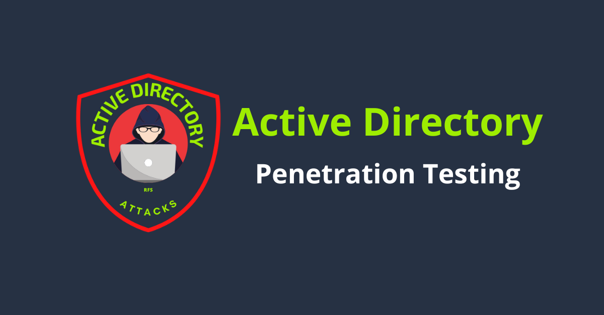
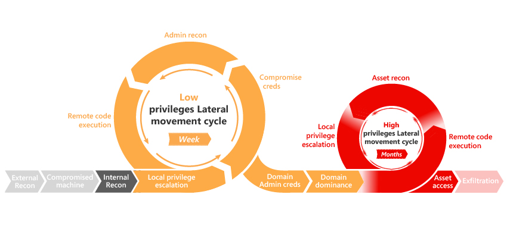

# ☠ Introduction

Welcome to my corner of Active Directory Hacking, my name is Muhammad Umar and here I keep notes about Penetration testing and Red Teaming on Windows Infrastructures.

<figure><figcaption>
Active Directory Penetration Testing
</figcaption></figure>

The Cyber Kill Chain in an Active Directory environment maps out the exact phases an attacker takes, from initial footprinting to gaining full domain dominance.

<figure><figcaption></figcaption></figure>
